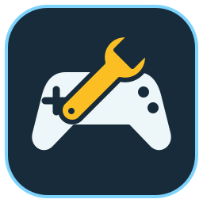

  

<h1 align="center">game-mods</h1>

<strong>Game mods, trainers, and scripts with tested release builds.</strong>

  
  
  

Mods for games I play. One folder per game, one subfolder per mod.

| Game | Mod | Kind | Status | Release | Nightly | Nightly scan |
| --- | --- | --- | --- | --- | --- | --- |
| Metro 2033 Redux | [trainer](metro-2033-redux/trainer/) | Windows trainer with a terminal dashboard | Experimental | [releases](https://github.com/edbfi/game-mods/releases?q=metro-2033-redux%2Ftrainer&expanded=true) | [download](https://nightly.link/edbfi/game-mods/workflows/nightly/main/metro-2033-redux-trainer-nightly.zip) | [VirusTotal][vt-metro-2033-redux-trainer] |
| Dawn of War – Definitive Edition | [munitorum-logistics](dawn-of-war-de/munitorum-logistics/) | Always-on wincondition script | Playable | [releases](https://github.com/edbfi/game-mods/releases?q=dawn-of-war-de%2Fmunitorum-logistics&expanded=true) | [download](https://nightly.link/edbfi/game-mods/workflows/nightly/main/dawn-of-war-de-munitorum-logistics-nightly.zip) | [VirusTotal][vt-dawn-of-war-de-munitorum-logistics] |

## Download

A **release** is a version of one mod picked to keep, with a version number. A **nightly** is the latest build of
`main`: every change, built and checked by the mod's tests, but not necessarily tried in-game. Each mod's README says how to install it.

Nightly downloads go through [nightly.link](https://nightly.link). If it fails, open the
[latest successful nightly run](https://github.com/edbfi/game-mods/actions/workflows/nightly.yml?query=branch%3Amain+is%3Asuccess)
and download the mod under **Artifacts** (this needs a GitHub sign-in).

Every download is submitted to VirusTotal: a release's report links are in its notes, a nightly's in the table
above and in its run's summary. A memory-patching trainer can still trip heuristic detections.

<!-- The nightly workflow rewrites the links between these markers after each scan. -->
<!-- nightly-virustotal:start -->
[vt-dawn-of-war-de-munitorum-logistics]: https://www.virustotal.com/gui/file/3653a3e130953b605ab71584932ba491547981872fcb50d1da702ee893aa7e63/detection
[vt-metro-2033-redux-trainer]: https://www.virustotal.com/gui/file/0e61e677f1cac389cc68377bd55304443b83f465f06e93f7270686a2ec44c1a1/detection
<!-- nightly-virustotal:end -->

## Develop

Each mod has a `justfile` with `test`, `build` and `package <version>`. From the repo root, `just test` and
`just build` run them for every mod.

## License

[AGPL-3.0-only](LICENSE), © edbfi.
